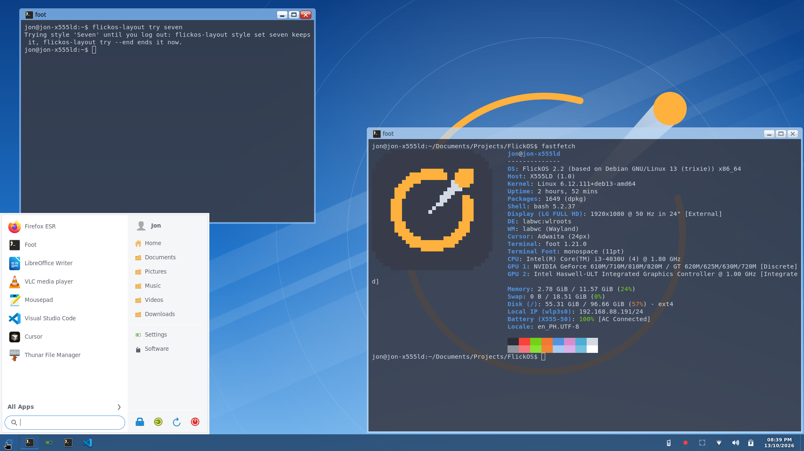
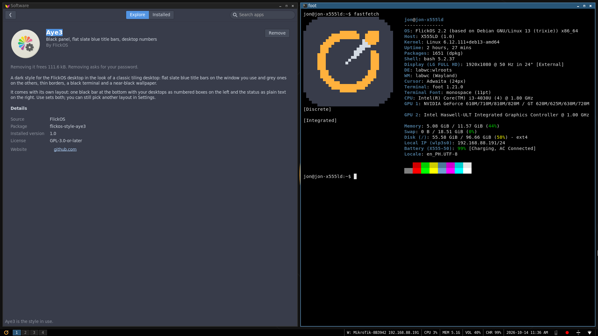

# FlickOS dotfiles: Seven and Aye3

Two looks for the [labwc](https://labwc.github.io/) Wayland compositor, made
for [FlickOS](https://github.com/dvbondoy/FlickOS) and packaged here as plain
dotfiles for any labwc setup.

| Seven | Aye3 |
|---|---|
|  |  |

**Seven** is light windows under see-through sky blue title bars with glassy
buttons, a see-through dark blue panel with a window list of icons, a black
console, and light notifications and launcher.

**Aye3** is flat slate blue title bars with thin borders, one black bar at the
bottom with desktop numbers and the status as plain text, an opaque black
terminal, and slate blue notifications.

## What's in it

Each look is a folder laid out like your home folder:

| File | Seven | Aye3 |
|---|---|---|
| `.config/labwc/rc.xml` | theme, keys, zoom | the same, plus 4 desktops and their keys |
| `.config/labwc/autostart` | swaybg, waybar, mako, nm-applet | the same |
| `.local/share/themes/NAME/labwc/` | `themerc` + SVG title bar buttons | `themerc` (labwc's own buttons) |
| `.config/waybar/` | bottom panel, 40 px, window list | bottom bar, 22 px, status as text |
| `.config/foot/foot.ini` | black, 95% opaque | black, opaque |
| `.config/fuzzel/fuzzel.ini` | light | grey |
| `.config/mako/config` | light | slate blue |
| `.local/share/backgrounds/` | `seven.png` | `aye3.png` |
| GTK theme / icons | Arc / Numix | Arc-Dark / Numix |

Details worth knowing:

- **Seven's title bars** are `#8cbdf0` at 75% opacity with black text. That
  keeps the text at least 4.5:1 against whatever window is behind, dark or
  light. labwc draws one flat color per title bar (no gradients, no blur), so
  the tint alone does the work.
- **Seven's panel** is `rgba(14, 42, 76, 0.82)`. The volume and battery are
  icons from the icon theme, with the value in the tooltip.
- **Aye3's colors**: focused title `#285577`, border `#4c7899`; inactive
  `#222222` / `#333333`, text `#8c8c8c`.
- **Aye3's bar** shows `W: essid ip | CPU 4% | MEM 1.2G | VOL 40% | BAT 87% | 2026-10-14 21:00`,
  in monospace, with CPU and memory read every 15 seconds.

## What you need

- labwc 0.8 or newer, waybar, foot, fuzzel, mako, swaybg
- Arc GTK theme and the Numix icon theme (Debian: `arc-theme`
  `numix-icon-theme`; Arch: `arc-gtk-theme`, Numix from your repos or the AUR)
- DejaVu fonts
- Used by the keys and the panel, if you want them: swaylock, grim, slurp,
  wl-clipboard, wireplumber (`wpctl`), playerctl, brightnessctl, pavucontrol,
  nm-applet, Thunar, Firefox

**Aye3's desktop numbers** use waybar's `ext/workspaces` module, which is
newer than waybar 0.12. With 0.12 (Debian 13), waybar logs
`Unknown module: ext/workspaces` and shows the bar without them. Super+1..4
still switch desktops.

## Install

```sh
git clone https://github.com/dvbondoy/flickos-dotfiles
cd flickos-dotfiles
./install.sh seven --dry-run   # shows what it would do
./install.sh seven             # or: ./install.sh aye3
```

`install.sh` copies the look's files into your home folder. Every file it
would replace is first copied to `~/.local/state/flickos-dotfiles/backup-DATE/`
at the same path. Then it sets the GTK theme, the icons and the light or dark
preference with `gsettings`. Log out and back in to labwc.

The files replace your labwc, waybar, foot, fuzzel and mako configs as a
whole. To keep your own keys, copy the parts you want from `rc.xml` into your
own instead of running the script.

To switch looks, run `install.sh` with the other one. With GNU Stow:
`stow -t ~ seven`, then set the themes yourself:

```sh
gsettings set org.gnome.desktop.interface gtk-theme Arc        # Aye3: Arc-Dark
gsettings set org.gnome.desktop.interface icon-theme Numix
gsettings set org.gnome.desktop.interface color-scheme prefer-light   # Aye3: prefer-dark
```

## Keys

| Key | |
|---|---|
| Super+Enter | Terminal (foot) |
| Super+D, Alt+F3 | App launcher (fuzzel) |
| Super+E / Super+B | Thunar / Firefox |
| Super+Q | Close the window |
| Super+L | Lock the screen |
| Super+Shift+E | Log out |
| Print / Shift+Print | Screenshot of an area / the screen, saved and copied |
| Super+= / Super+- / Super+0, Super+scroll | Zoom |
| Alt+Tab, Alt+F4, snapping | labwc's own |
| **Aye3:** Super+1..4 | Go to desktop 1..4 |
| **Aye3:** Super+Shift+1..4 | Move the window to desktop 1..4 |
| **Aye3:** Super+Ctrl+Left/Right | Previous / next desktop (with Shift: take the window) |

## On FlickOS

On FlickOS both looks are packages: install them from *Software → Styles*,
or with `sudo apt install flickos-style-seven flickos-style-aye3`, and pick
them in *Settings → Desktop Layout & Style*. You don't need these dotfiles
there.

Some things in the screenshots are FlickOS programs and aren't in these
dotfiles: the start menu and Quick Settings (`flickos-menu`), tiling
(`flick-tiler`, Super+T), the Show Desktop strip at the panel's right end,
and the screenshot tool. Their source is in the
[FlickOS repository](https://github.com/dvbondoy/FlickOS) under `packages/`.

## License

GPL-3.0-or-later (`LICENSE`). The window themes, buttons, wallpapers and the
FlickOS logo are FlickOS's own work under the same license. Arc, Numix,
labwc, waybar and the other programs are their authors' and are not included
here.
